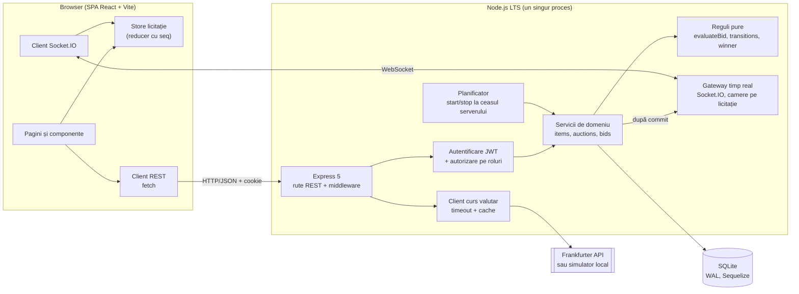
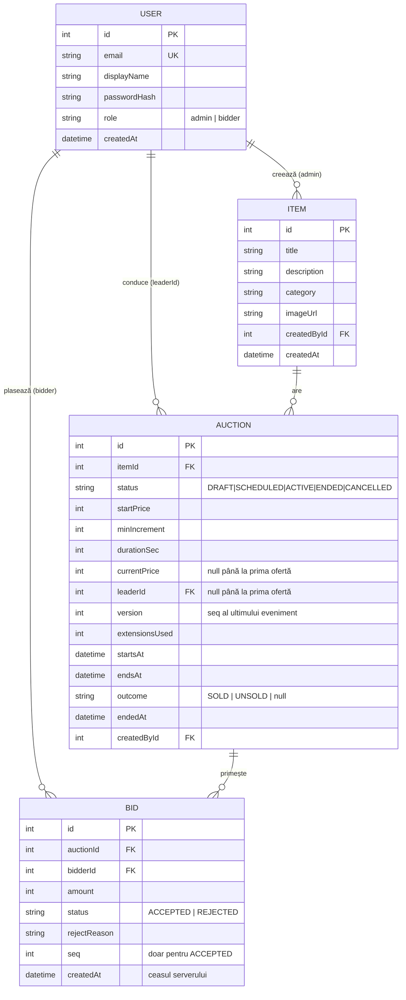

# Arhitectură — Licitații în timp real

> Etapa **M1**: schiță de arhitectură, schema de date, contractul API și protocolul live.
> Deciziile pentru pachete sunt în [packages/](packages/) și [adr/](adr/).

## 1. Vedere de ansamblu



**Principii**

1. **O singură cale de scriere**: ofertele se plasează doar prin `POST /api/auctions/:id/bids` (REST). WebSocket-ul este folosit numai pentru notificări server → client; serverul ignoră orice „ofertă” trimisă pe socket.
2. **Serverul este sursa adevărului** pentru timp, preț, lider și rezultat. Clientul doar afișează și reconciliază.
3. **Evenimentele se emit doar după commit**: dacă tranzacția eșuează, nu se trimite nimic.
4. **Regulile de business sunt funcții pure** (fără I/O), testabile unitar; serviciile le aplică în tranzacții.
5. **Ceas injectabil** (`clock.now()`) pentru teste deterministe de termen-limită.

## 2. Tehnologii

| Strat | Alegere | Motivare |
|---|---|---|
| Limbaj | JavaScript, module ECMAScript | cerință generală |
| Runtime | Node.js LTS (≥ 22) | cerință generală; `process.loadEnvFile`, `node --test` |
| API | Express 5 | cerință; erorile din handler-ele `async` ajung automat în middleware-ul de erori |
| ORM / DB | Sequelize 6 + SQLite (`sqlite3`) | cerință; fără server de DB; WAL pentru citiri concurente |
| Timp real | Socket.IO 4 | camere, reconectare automată, autentificare la handshake; vezi [ADR-0001](adr/0001-rtm-transport-si-reconciliere.md) |
| Front-end | React + Vite, React Router | cerință |
| Autentificare | `bcryptjs` + `jsonwebtoken`, cookie `httpOnly` | parole hash-uite, fără sesiuni pe server |
| Validare | scheme `zod` pe server | mesaje coerente, o singură sursă pentru reguli de format |
| Teste server | `node:test` + `supertest` + `c8` (coverage) | ca la seminarii; ESM nativ, fără configurare |
| Teste client | Vitest + Testing Library | integrat cu Vite |
| E2E | Playwright | mai multe contexte de browser (organizator + 2 licitatori) |
| Încărcare | Artillery (motor HTTP + Socket.IO) | suportă nativ Socket.IO; vezi [capacity.md](capacity.md) |

Dependențele se adaugă în momentul în care sunt folosite (scheletul M1 conține doar ce rulează deja).

## 3. Structura repozitoriului

```
licitatii-live/
├── server/                 API Express + Socket.IO + Sequelize
│   ├── src/
│   │   ├── app.js          creează aplicația Express (fără listen) – testabilă
│   │   ├── server.js       pornește HTTP + Socket.IO + planificator
│   │   ├── config.js       citește .env, valori implicite
│   │   ├── db.js           conexiune Sequelize, PRAGMA-uri SQLite
│   │   ├── models/         User, Item, Auction, Bid + asocieri
│   │   ├── domain/         reguli pure (bid-rules, auction-states, winner)   [M2]
│   │   ├── services/       tranzacții și orchestrare                          [M2]
│   │   ├── routes/         rute REST                                          [M2]
│   │   ├── realtime/       gateway Socket.IO                                  [M2]
│   │   ├── integrations/   client curs valutar + simulator                    [M2]
│   │   ├── errors.js       erori de domeniu → coduri HTTP
│   │   └── seed.js         date sintetice deterministe
│   └── tests/              unit / integration / con / rtm
├── client/                 SPA React + Vite
├── load/                   scenarii Artillery + verificare invariante         [M2/M3]
├── e2e/                    teste Playwright                                   [M3]
└── docs/                   documentație (acest folder)
```

## 4. Modelul de date



### Constrângeri de integritate

| Tabel | Constrângere | Scop |
|---|---|---|
| `Users` | `email` UNIQUE, NOT NULL, format e-mail; `role` ∈ {`admin`,`bidder`} | identitate, roluri |
| `Items` | `title` NOT NULL (3–120 caractere); FK `createdById` → `Users` (RESTRICT) | |
| `Auctions` | FK `itemId` → `Items` (RESTRICT); `status` ∈ listă; `startPrice` ≥ 1; `minIncrement` ≥ 1; `durationSec` ∈ [30, 604800]; `version` ≥ 0 | |
| `Auctions` | **index unic parțial** `(itemId) WHERE status IN ('DRAFT','SCHEDULED','ACTIVE')` | **I7** – cel mult o licitație nefinalizată per obiect |
| `Bids` | FK `auctionId` → `Auctions` (RESTRICT), FK `bidderId` → `Users` (RESTRICT); `amount` ≥ 1; `status` ∈ {`ACCEPTED`,`REJECTED`} | |
| `Bids` | **index unic parțial** `(auctionId, amount) WHERE status='ACCEPTED'` | **I4** – două oferte acceptate nu pot avea aceeași sumă |
| `Bids` | **index unic parțial** `(auctionId, seq) WHERE status='ACCEPTED'` | **I4** – ordine totală a ofertelor acceptate |
| `Bids` | index `(auctionId, createdAt)`, `(bidderId, createdAt)` | istoric și „ofertele mele” paginate |
| `Auctions` | index `(status, endsAt)` | planificator, listare filtrată |

Observații:

- Pe SQLite, `ENUM` este stocat ca `TEXT` fără validare; folosim `STRING` + `validate: { isIn: [[...]] }` în model și verificări în servicii.
- Sumele sunt `INTEGER` (lei întregi) — evită erorile de rotunjire.
- `leaderId` referă utilizatorul (nu oferta), evitând o dependență circulară `Auctions ↔ Bids`. Oferta câștigătoare = oferta `ACCEPTED` cu `seq` maxim.
- `passwordHash` este exclus din `defaultScope`, deci nu poate ajunge accidental într-un răspuns.

## 5. Contractul API REST

Bază: `/api`. Format JSON. Autentificare: cookie `httpOnly` `token` (JWT). Colecțiile paginate răspund cu
`{ "data": [...], "meta": { "page", "limit", "total", "totalPages" } }`.

### Format unic de eroare

```json
{ "error": { "code": "BID_TOO_LOW", "message": "Oferta minimă acceptată este 1.250 lei.", "details": { "minAmount": 1250 } } }
```

| HTTP | Coduri |
|---|---|
| 400 | `VALIDATION_ERROR`, `INVALID_JSON` |
| 401 | `UNAUTHENTICATED`, `INVALID_CREDENTIALS` |
| 403 | `FORBIDDEN` |
| 404 | `NOT_FOUND` (inclusiv licitații `DRAFT` cerute de un licitator — nu dezvăluim existența) |
| 409 | `EMAIL_TAKEN`, `ITEM_HAS_OPEN_AUCTION`, `ITEM_IN_USE`, `INVALID_TRANSITION`, `AUCTION_NOT_EDITABLE`, `AUCTION_HAS_BIDS`, `AUCTION_NOT_ACTIVE`, `AUCTION_CLOSED`, `BID_TOO_LOW`, `ALREADY_LEADING` |
| 429 | `RATE_LIMITED` (autentificare) |
| 502/503 | `RATES_UNAVAILABLE` |
| 500 | `INTERNAL_ERROR` (fără stack trace în răspuns) |

### Endpointuri

| Metodă | Cale | Rol | Descriere | Răspuns |
|---|---|---|---|---|
| GET | `/api/health` | public | stare server + DB | 200 |
| POST | `/api/auth/register` | public | `{email, password, displayName}` → cont **bidder** | 201 / 400 / 409 |
| POST | `/api/auth/login` | public | `{email, password}` → setează cookie | 200 / 401 / 429 |
| POST | `/api/auth/logout` | autentificat | șterge cookie | 204 |
| GET | `/api/auth/me` | autentificat | utilizatorul curent (fără hash) | 200 / 401 |
| GET | `/api/items` | autentificat | `q`, `category`, `sort`, `page`, `limit` | 200 |
| GET | `/api/items/:id` | autentificat | detalii + licitația curentă | 200 / 404 |
| POST | `/api/items` | admin | creare obiect | 201 + `Location` |
| PATCH | `/api/items/:id` | admin | editare | 200 / 404 |
| DELETE | `/api/items/:id` | admin | ștergere dacă nu are licitații | 204 / 409 |
| GET | `/api/auctions` | autentificat | **filtrare** `status`, `category`, `q`, `minPrice`, `maxPrice`; **ordonare** `sort` ∈ {`endsAt`,`-endsAt`,`currentPrice`,`-currentPrice`,`createdAt`,`-createdAt`}; **paginare** `page`, `limit` | 200 |
| GET | `/api/auctions/:id` | autentificat | instantaneu: licitație, obiect, lider (`displayName`), `serverNow`, `version` | 200 / 404 |
| POST | `/api/auctions` | admin | `{itemId, startPrice, minIncrement, durationSec}` → `DRAFT` | 201 / 400 / 409 |
| PATCH | `/api/auctions/:id` | admin | modifică parametrii, doar în `DRAFT` | 200 / 409 |
| PUT | `/api/auctions/:id/status` | admin | `{status: "SCHEDULED"|"ACTIVE"|"DRAFT"|"CANCELLED", startsAt?}` – tranziție **idempotentă** | 200 / 409 |
| GET | `/api/auctions/:id/bids` | autentificat | istoric: `status`, `afterSeq`, `sort`, `page`, `limit` | 200 |
| POST | `/api/auctions/:id/bids` | bidder | `{amount}` | 201 / 400 / 403 / 409 |
| GET | `/api/me/bids` | bidder | ofertele proprii (identitatea din token, niciodată din URL) | 200 |
| GET | `/api/me/wins` | bidder | licitațiile câștigate | 200 |
| GET | `/api/rates` | autentificat | `base=RON`, `symbols=EUR,USD` → `{base, rates, fetchedAt, source, stale}` | 200 / 503 |

`ENDED` nu poate fi cerut prin API: tranziția `ACTIVE → ENDED` o face doar planificatorul.

### Exemplu — plasarea unei oferte

```http
POST /api/auctions/7/bids
Content-Type: application/json
Cookie: token=…

{ "amount": 1250 }
```

```json
201 Created
{ "data": {
    "bid": { "id": 311, "amount": 1250, "seq": 14, "createdAt": "2026-12-01T18:00:03.120Z" },
    "auction": { "id": 7, "status": "ACTIVE", "currentPrice": 1250, "leader": { "id": 12, "displayName": "Ana" },
                 "minNextBid": 1300, "version": 14, "endsAt": "2026-12-01T18:05:00.000Z" },
    "serverNow": "2026-12-01T18:00:03.121Z" } }
```

## 6. Protocolul în timp real (Socket.IO)

Conexiune: `io({ withCredentials: true })` pe aceeași origine. La handshake serverul citește cookie-ul `token`,
verifică JWT-ul și atașează `socket.data.user`; fără token valid → `connect_error` cu `UNAUTHENTICATED`.

| Direcție | Eveniment | Payload | Note |
|---|---|---|---|
| C → S | `auction:join` | `{ auctionId }` | ack `{ ok, snapshot }` sau `{ ok:false, error:{code} }`; licitator + `DRAFT` → `NOT_FOUND` |
| C → S | `auction:leave` | `{ auctionId }` | |
| C → S | `lobby:join` | – | actualizări pentru lista de licitații |
| S → C | `bid:accepted` | `{ auctionId, seq, bid:{id, amount, bidder:{id, displayName}, createdAt}, currentPrice, minNextBid, leader, endsAt, serverTime }` | doar camera `auction:<id>` |
| S → C | `auction:status` | `{ auctionId, seq, status, outcome?, winner?, startsAt?, endsAt?, serverTime }` | camera licitației + lobby |
| S → C | `auction:extended` *(opțional)* | `{ auctionId, seq, endsAt, serverTime }` | |
| S → C | `lobby:auction` | `{ auctionId, seq, status, currentPrice, endsAt }` | camera `lobby` |

**Reconciliere** (detalii în [packages/rtm-timp-real.md](packages/rtm-timp-real.md)): clientul păstrează `lastSeq` per licitație;
aplică un eveniment doar dacă `seq === lastSeq + 1`; ignoră `seq ≤ lastSeq` (duplicat/vechi); la `seq > lastSeq + 1`
(gol) sau după reconectare cere un instantaneu nou (`auction:join` din nou → `snapshot`) și completează istoricul cu
`GET /api/auctions/:id/bids?afterSeq=lastSeq`.

**Countdown**: fiecare instantaneu/eveniment conține `serverTime`; clientul calculează `offset = serverTime − Date.now()`
și afișează `endsAt − (Date.now() + offset)`. Afișarea este informativă — decizia aparține serverului (R3).

## 7. Fluxul unei oferte (cu tranzacție)

```mermaid
sequenceDiagram
    autonumber
    participant B as Licitator (browser)
    participant API as Express
    participant S as BidService
    participant DB as SQLite
    participant RT as Socket.IO
    participant O as Alți clienți

    B->>API: POST /api/auctions/7/bids {amount}
    API->>API: autentificare, rol bidder, validare zod
    API->>S: placeBid(auctionId, bidderId, amount)
    S->>DB: BEGIN IMMEDIATE (lock de scriere)
    S->>DB: SELECT auction; now = clock.now()
    S->>S: evaluateBid(auction, {bidderId, amount, role}, now) (funcție pură)
    alt ofertă validă
        S->>DB: UPDATE Auctions SET currentPrice, leaderId, version=version+1 WHERE id=? AND version=? AND status='ACTIVE' AND endsAt>?
        S->>DB: INSERT Bid (ACCEPTED, seq=version+1)
    else ofertă invalidă
        S->>DB: INSERT Bid (REJECTED, rejectReason)
    end
    S->>DB: COMMIT
    S-->>API: rezultat
    API-->>B: 201 / 409
    S->>RT: emit bid:accepted (doar după commit, doar dacă ACCEPTED)
    RT-->>O: bid:accepted {seq, …}
```

Detalii și alternative: [packages/con-concurenta.md](packages/con-concurenta.md), [ADR-0002](adr/0002-con-consistenta-ofertelor.md).

## 8. Securitate

| Subiect | Tratament |
|---|---|
| Parole | `bcryptjs`, cost 12; minimum 8 caractere; hash-ul nu iese din serviciul de autentificare |
| Sesiune | JWT HS256 (expirare 8 h) în cookie `httpOnly`, `SameSite=Strict`, `Secure` în producție; secretul `JWT_SECRET` doar în `.env` |
| CSRF | `SameSite=Strict` + rutele de scriere acceptă doar `Content-Type: application/json` |
| CORS | în dezvoltare Vite face proxy → aceeași origine; în producție Express servește build-ul SPA → aceeași origine. CORS rămâne dezactivat; dacă e nevoie, doar `CLIENT_ORIGIN` din `.env`, cu `credentials: true` |
| Autorizare | middleware `requireAuth` + `requireRole('admin'|'bidder')` pe fiecare rută; verificare pe obiect (licitator + `DRAFT` → 404; „ofertele mele” filtrate după `req.user.id`) |
| WebSocket | autentificare la handshake; autorizare la fiecare `auction:join`; serverul nu acceptă evenimente de scriere de la client |
| Validare | scheme `zod` pentru body/query/params; respingere câmpuri necunoscute; limite de lungime |
| SQL | doar Sequelize (interogări parametrizate); orice interogare brută folosește `replacements` |
| Date sensibile | răspunsurile nu conțin `passwordHash`, e-mailul altor utilizatori sau token-ul; jurnalele nu conțin corpul cererilor de autentificare |
| Abuz | limitare de rată la `/api/auth/login` (ex. 10 încercări / 15 min / IP) |
| Erori | handler central; `500` fără stack trace; detaliile tehnice doar în jurnalul serverului |
| Antete | `helmet` (CSP permisiv doar pentru resursele proprii) |

## 9. Integrarea externă — curs valutar

- **Furnizor**: Frankfurter (cursuri BCE, gratuit, fără cheie). URL configurabil prin `RATES_BASE_URL`.
- **Contract intern**: `getRates(base, symbols) → { base, rates: { EUR, USD }, fetchedAt, source, stale }`.
- **Comportament**: timeout 2 s; cache în memorie 1 h; la eroare se servește ultima valoare cunoscută cu `stale: true`; fără cache → `503 RATES_UNAVAILABLE`, iar UI afișează doar prețul în RON.
- **Simulator** (`RATES_PROVIDER=simulator`): răspunsuri deterministe și moduri de eroare (`timeout`, `500`, `malformed`) pentru teste și pentru cost zero.
- Nu se trimit date ale utilizatorilor către serviciul extern.

## 10. Planificatorul (ceasul serverului)

- Rulează în procesul serverului, la fiecare 250 ms: `SCHEDULED` cu `startsAt ≤ now` → `ACTIVE`; `ACTIVE` cu `endsAt ≤ now` → `ENDED`.
- Fiecare tranziție este o tranzacție separată, cu `UPDATE … WHERE status = <stare așteptată>` → dacă două tick-uri se suprapun, doar unul reușește.
- Invariantele nu depind de punctualitatea planificatorului: o ofertă după `endsAt` este respinsă chiar dacă licitația figurează încă `ACTIVE` (R3 se verifică la fiecare ofertă).
- La pornirea serverului se închid imediat licitațiile expirate cât timp serverul a fost oprit.

## 11. Mod producție

`npm run build` construiește SPA-ul în `client/dist`; `npm start` pornește Express cu `NODE_ENV=production`,
care servește atât API-ul cât și fișierele statice (aceeași origine, fără CORS). Demonstrația rulează local.
