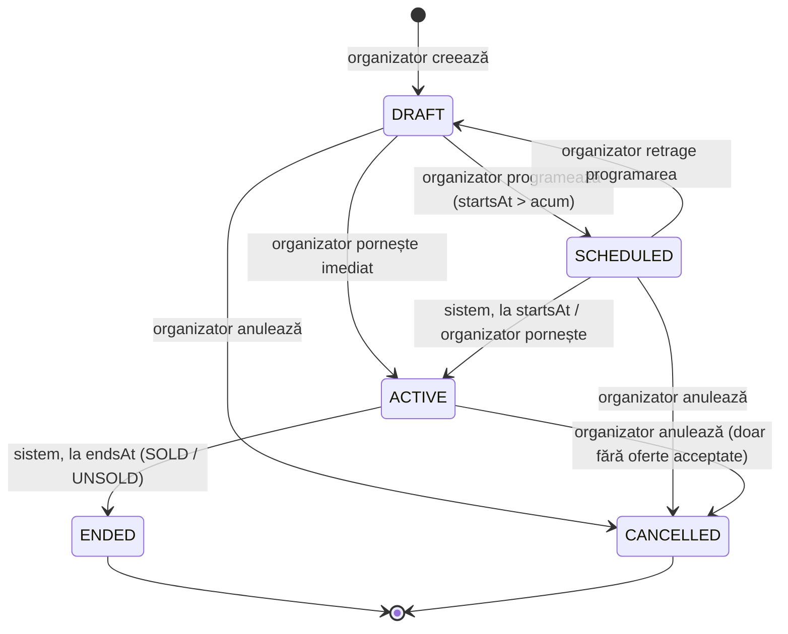

# Cerințe — Licitații în timp real

> Echipa **mafia team** · Etapa **M1 — Analiză/design** · Pachete obligatorii: **RTM** + **CON**

## 1. Context și scop

Aplicația permite organizarea unor **licitații fictive** (fără bani reali) pentru obiecte dintr-un catalog.
Mai mulți licitatori urmăresc simultan aceeași licitație, plasează oferte concurente și văd live
prețul curent, liderul, istoricul ofertelor și timpul rămas. La expirarea termenului decis de server
este desemnat automat câștigătorul.

### În afara scopului

- plăți reale, portofel, facturare, livrare;
- licitații de tip olandez / cu plic sigilat / ofertă automată (proxy bidding);
- notificări prin e-mail/SMS;
- aplicații mobile native (interfața web este responsivă).

## 2. Actori și roluri

| Actor | Tip | Descriere |
|---|---|---|
| **Vizitator** | neautentificat | Își poate crea cont de licitator și se poate autentifica. Nu vede licitațiile. |
| **Licitator** (`bidder`) | rol obișnuit | Navighează catalogul, urmărește licitații live, plasează oferte, își vede ofertele și câștigurile. |
| **Organizator** (`admin`) | rol privilegiat | Administrează obiectele, creează, programează, pornește și anulează licitații. **Nu poate licita.** |
| **Sistem / ceas server** | actor tehnic | Pornește licitațiile programate și închide licitațiile la `endsAt`, desemnând câștigătorul. |
| **Serviciu extern de curs valutar** | sistem extern | Furnizează cursul RON → EUR/USD pentru afișarea informativă a prețurilor (Frankfurter sau simulator local). |

Conturile de organizator **nu** se pot crea prin înregistrare publică; ele există doar din seed / configurare.

### Matrice de permisiuni (verificată pe server la fiecare operație)

| Operație | Vizitator | Licitator | Organizator |
|---|:-:|:-:|:-:|
| Înregistrare / autentificare | ✅ | – | – |
| Listare obiecte și licitații (fără `DRAFT`) | ❌ | ✅ | ✅ |
| Vizualizare licitații `DRAFT` | ❌ | ❌ | ✅ |
| Creare / editare / ștergere obiect | ❌ | ❌ | ✅ |
| Creare / editare licitație (în `DRAFT`) | ❌ | ❌ | ✅ |
| Programare / pornire / anulare licitație | ❌ | ❌ | ✅ |
| Plasare ofertă | ❌ | ✅ | ❌ |
| Istoric oferte al unei licitații | ❌ | ✅ | ✅ |
| Ofertele mele / câștigurile mele | ❌ | ✅ (doar ale sale) | – |
| Abonare live la o licitație (WebSocket) | ❌ | ✅ (fără `DRAFT`) | ✅ |
| Curs valutar | ❌ | ✅ | ✅ |

## 3. Cazuri de utilizare

| ID | Caz de utilizare | Actor principal |
|---|---|---|
| UC1 | Înregistrare cont de licitator | Vizitator |
| UC2 | Autentificare / deconectare | Licitator, Organizator |
| UC3 | Administrare obiecte (CRUD) | Organizator |
| UC4 | Creare licitație pentru un obiect (preț de pornire, pas minim, durată) | Organizator |
| UC5 | Programare / pornire / anulare licitație | Organizator |
| UC6 | Căutare, filtrare, ordonare și paginare licitații | Licitator, Organizator |
| UC7 | Urmărire live a unei licitații (preț, lider, countdown, istoric) | Licitator, Organizator |
| UC8 | Plasare ofertă | Licitator |
| UC9 | Încheiere automată și desemnarea câștigătorului | Sistem |
| UC10 | Consultare „Ofertele mele” și „Licitații câștigate” | Licitator |
| UC11 | Reconectare după pierderea conexiunii și resincronizare | Licitator, Organizator |
| UC12 | Afișare preț echivalent în EUR/USD | Licitator, Organizator |
| UC13 *(opțional)* | Prelungire anti-sniping la oferte în ultimele secunde | Sistem |

## 4. Fluxuri utilizator complete și criterii de acceptare

Criteriile sunt scrise în forma *Dat fiind / Când / Atunci* și sunt urmărite în [testing.md](testing.md) (matricea de trasabilitate).

### F1 — Organizatorul publică și pornește o licitație (UC3, UC4, UC5)

1. Organizatorul adaugă un obiect (titlu, descriere, categorie, imagine opțională).
2. Creează o licitație `DRAFT` pentru obiect: preț de pornire, pas minim, durată.
3. O programează (`SCHEDULED`, cu `startsAt` în viitor) sau o pornește imediat (`ACTIVE`).

- **AC1.1** Dat fiind un organizator autentificat, când creează un obiect valid, atunci primește `201` și obiectul apare în catalog.
- **AC1.2** Când creează o licitație cu `startPrice ≤ 0`, `minIncrement ≤ 0` sau durată în afara intervalului [30 s, 7 zile], atunci primește `400 VALIDATION_ERROR` și nu se persistă nimic.
- **AC1.3** Când încearcă să creeze o a doua licitație nefinalizată (`DRAFT`/`SCHEDULED`/`ACTIVE`) pentru același obiect, atunci primește `409 ITEM_HAS_OPEN_AUCTION` (constrângere și în baza de date).
- **AC1.4** Când pornește licitația, atunci serverul fixează `startsAt = acum` și `endsAt = acum + durată` după ceasul **serverului**, iar licitatorii conectați la lobby văd licitația nouă fără refresh.
- **AC1.5** Dat fiind un **licitator**, când apelează orice operație de creare/pornire/anulare, atunci primește `403 FORBIDDEN` și starea nu se schimbă.
- **AC1.6** Când trimite de două ori aceeași tranziție (ex. `ACTIVE` → `ACTIVE`), atunci a doua cerere răspunde `200` cu starea curentă, fără efecte suplimentare (idempotență).

### F2 — Licitatorul licitează live (UC6, UC7, UC8)

1. Licitatorul caută/filtrează licitațiile active și deschide una.
2. Vede prețul curent, liderul, pasul minim, countdown-ul și istoricul, actualizate live.
3. Introduce o sumă și trimite oferta.

- **AC2.1** Dat fiind o licitație `ACTIVE`, când licitatorul trimite o sumă ≥ minimul curent înainte de `endsAt`, atunci primește `201`, devine lider, iar **toți** clienții abonați primesc evenimentul `bid:accepted` fără refresh.
- **AC2.2** Când suma este sub minimul curent, atunci primește `409 BID_TOO_LOW` cu minimul curent în `details`, iar liderul și prețul nu se schimbă.
- **AC2.3** Când oferta ajunge la server după `endsAt` (ceasul serverului), atunci primește `409 AUCTION_CLOSED`, indiferent de ce afișa countdown-ul clientului.
- **AC2.4** Când liderul curent încearcă să-și supraliciteze propria ofertă, atunci primește `409 ALREADY_LEADING`.
- **AC2.5** Când suma nu este un întreg pozitiv (șir, zecimal, negativ, lipsă, > 1.000.000.000), atunci primește `400 VALIDATION_ERROR`.
- **AC2.6** În timpul trimiterii, butonul este dezactivat și se afișează starea „Se trimite…”; erorile sunt afișate lângă formular, în limbaj clar.

### F3 — Încheierea licitației și desemnarea câștigătorului (UC9, UC10)

1. Ceasul serverului atinge `endsAt`.
2. Sistemul trece licitația în `ENDED`, cu rezultat `SOLD` (dacă există oferte acceptate) sau `UNSOLD`.
3. Toți clienții abonați văd rezultatul; câștigătorul îl vede în „Licitații câștigate”.

- **AC3.1** Dat fiind o licitație cu oferte acceptate, când expiră, atunci câștigătorul este autorul ofertei acceptate cu cea mai mare valoare (echivalent: ultima ofertă acceptată, cu `seq` maxim).
- **AC3.2** Rezultatul este **determinist**: recalcularea din istoricul din baza de date produce același câștigător și același preț final, indiferent de ordinea în care evenimentele au ajuns la clienți.
- **AC3.3** După `ENDED` orice ofertă este respinsă cu `409 AUCTION_CLOSED`, iar orice tranziție manuală este respinsă cu `409 INVALID_TRANSITION`.
- **AC3.4** O licitație fără oferte se închide cu `outcome = UNSOLD` și fără câștigător.

### F4 — Reconectare și resincronizare (UC11)

- **AC4.1** Dat fiind un client care pierde conexiunea în timp ce se plasează oferte, când se reconectează, atunci starea afișată (preț, lider, `seq`, `endsAt`, status) devine identică cu cea din baza de date, fără refresh manual.
- **AC4.2** În timpul deconectării, interfața afișează „Reconectare…” și dezactivează trimiterea de oferte.
- **AC4.3** Dacă două evenimente ajung la client în ordine inversă, starea finală afișată este cea corespunzătoare `seq` maxim; evenimentele vechi sau duplicate sunt ignorate, iar un gol în `seq` declanșează resincronizare.

### F5 — Catalog cu filtrare, ordonare și paginare (UC6)

- **AC5.1** `GET /api/auctions` acceptă filtre `status`, `category`, `q` (titlu), `minPrice`, `maxPrice`, ordonare `sort` (ex. `endsAt`, `-currentPrice`) și paginare `page`/`limit` (implicit 1/12, maxim 50).
- **AC5.2** Răspunsul conține `meta: { page, limit, total, totalPages }`; paginile nu se suprapun și nu omit elemente pentru o ordonare stabilă (cheie secundară `id`).
- **AC5.3** Parametri invalizi (`limit=0`, `sort=parola`, `status=FOO`) → `400 VALIDATION_ERROR`.
- **AC5.4** Licitatorii nu văd niciodată licitații `DRAFT`, nici prin filtru explicit.

## 5. Reguli de business

| ID | Regulă |
|---|---|
| R1 | Prima ofertă acceptată trebuie să fie ≥ `startPrice`. |
| R2 | Orice ofertă ulterioară trebuie să fie ≥ `currentPrice + minIncrement`. |
| R3 | O ofertă este acceptată doar dacă licitația este `ACTIVE` și `now_server < endsAt`. Ceasul clientului nu contează. |
| R4 | Liderul curent nu poate plasa o nouă ofertă cât timp este lider. |
| R5 | Organizatorii nu pot licita (separarea rolurilor). |
| R6 | Sumele sunt numere întregi de lei (fără zecimale), în intervalul [1, 1.000.000.000]. |
| R7 | Un obiect are cel mult o licitație nefinalizată (`DRAFT`, `SCHEDULED` sau `ACTIVE`). |
| R8 | Parametrii unei licitații (`startPrice`, `minIncrement`, durată) se pot modifica doar în `DRAFT`. |
| R9 | O licitație `ACTIVE` poate fi anulată doar dacă nu are oferte acceptate. |
| R10 | Câștigătorul este autorul ofertei acceptate cu valoarea maximă; deoarece ofertele acceptate sunt strict crescătoare, aceasta are și `seq` maxim. |
| R11 | Fiecare eveniment care schimbă starea unei licitații (ofertă acceptată, tranziție, prelungire) incrementează contorul `version` al licitației; valoarea devine `seq`-ul evenimentului. |
| R12 | Ofertele respinse sunt păstrate în istoric cu motivul respingerii, dar nu modifică `currentPrice`, `leaderId` sau `version`. |
| R13 *(opțional)* | O ofertă acceptată cu mai puțin de `extendWindowSec` secunde înainte de `endsAt` prelungește licitația cu `extendBySec` secunde, de cel mult `maxExtensions` ori. |

## 6. Invariante critice (protejate în backend / baza de date)

| ID | Invariantă | Unde este protejată | Cum se verifică |
|---|---|---|---|
| **I1** | Orice ofertă `ACCEPTED` respectă minimul valabil în momentul acceptării (R1/R2). | Tranzacție SQLite `IMMEDIATE` + `UPDATE` condiționat (compare-and-set) pe licitație | teste unitare + test concurent CON |
| **I2** | Orice ofertă `ACCEPTED` are `createdAt < endsAt` al licitației, după ceasul serverului (R3). | Condiție `endsAt > :now` în același `UPDATE` condiționat | test de integrare cu ceas injectat |
| **I3** | O ofertă respinsă nu schimbă liderul, prețul sau `version` (R12). | Ramura de respingere scrie doar în `bids` | test de integrare + verificare DB după testul de încărcare |
| **I4** | Pentru o licitație, ofertele `ACCEPTED` au sume distincte și `seq` distincte, iar sumele sunt strict crescătoare în ordinea `seq`, cu diferență ≥ `minIncrement`. | Index unic parțial `(auctionId, amount) WHERE status='ACCEPTED'` și `(auctionId, seq) WHERE status='ACCEPTED'` | test CON: 20 oferte simultane la același preț → exact 1 acceptată |
| **I5** | `auction.currentPrice` și `auction.leaderId` coincid cu oferta `ACCEPTED` cu `seq` maxim (dacă există). | Actualizate în aceeași tranzacție cu inserarea ofertei | script `verify-invariants` după fiecare test de încărcare |
| **I6** | Rezultatul final este determinist: `winner` = autorul ofertei acceptate cu sumă maximă; `UNSOLD` dacă nu există. | Calculat pe server din DB la tranziția `ACTIVE → ENDED` | test unitar + recalculare din DB |
| **I7** | Un obiect are cel mult o licitație nefinalizată (R7). | Index unic parțial `(itemId) WHERE status IN ('DRAFT','SCHEDULED','ACTIVE')` | test de integrare `409` |

## 7. Mașina de stări a licitației

| De la | La | Actor | Condiție |
|---|---|---|---|
| `DRAFT` | `SCHEDULED` | organizator | `startsAt` în viitor (≥ acum + 30 s) |
| `DRAFT` | `ACTIVE` | organizator | – ; serverul fixează `startsAt` și `endsAt` |
| `SCHEDULED` | `ACTIVE` | sistem / organizator | `now ≥ startsAt` sau pornire manuală |
| `SCHEDULED` | `DRAFT` | organizator | – |
| `DRAFT`, `SCHEDULED` | `CANCELLED` | organizator | – |
| `ACTIVE` | `CANCELLED` | organizator | nicio ofertă acceptată (R9) |
| `ACTIVE` | `ENDED` | **doar sistemul** | `now ≥ endsAt`; `outcome` = `SOLD` / `UNSOLD` |

Orice altă tranziție → `409 INVALID_TRANSITION`. O tranziție către starea curentă → `200` fără efect (idempotentă).
`ENDED` și `CANCELLED` sunt stări finale.

## 8. Cerințe nefuncționale

| Categorie | Cerință |
|---|---|
| Performanță | Profil de sarcină și obiective în [capacity.md](capacity.md): 20 licitatori simultani, 100 oferte, p95 `POST bid` ≤ 200 ms, p95 întârziere de propagare live ≤ 300 ms, 0% erori 5xx. |
| Timp real | Clienții văd modificările fără refresh; starea învechită este detectată prin `seq` și reconciliată. |
| Securitate | Parole hash-uite (bcrypt), JWT în cookie `httpOnly`, autorizare pe fiecare rută și pe fiecare mesaj WebSocket, validare server, interogări parametrizate, fără date sensibile în răspunsuri/jurnale. Detalii în [architecture.md](architecture.md#8-securitate). |
| Utilizabilitate | Interfață responsivă (≥ 360 px), stări de încărcare/eroare/gol, mesaje de eroare clare în română. |
| Reproducibilitate | Seed sintetic determinist, scripturi pentru test/coverage/încărcare, `.env.example`. |
| Portabilitate | Rulează local pe Windows/macOS/Linux cu Node.js LTS; fără servicii plătite. |

## 9. Ipoteze și întrebări deschise pentru titular

1. Fișa temei nu fixează praguri de latență; echipa propune p95 ≤ 200 ms pentru oferte și ≤ 300 ms pentru propagarea live (vezi [capacity.md](capacity.md)).
2. Interpretăm „100 oferte” ca 100 de încercări de ofertare trimise de 20 de licitatori către aceeași licitație („licitație fierbinte”), inclusiv oferte concurente la același preț.
3. Monedă unică: RON, sume întregi. Conversia EUR/USD este doar informativă.
4. Extensia anti-sniping (R13) este planificată ca opțională, după finalizarea cerințelor obligatorii.
